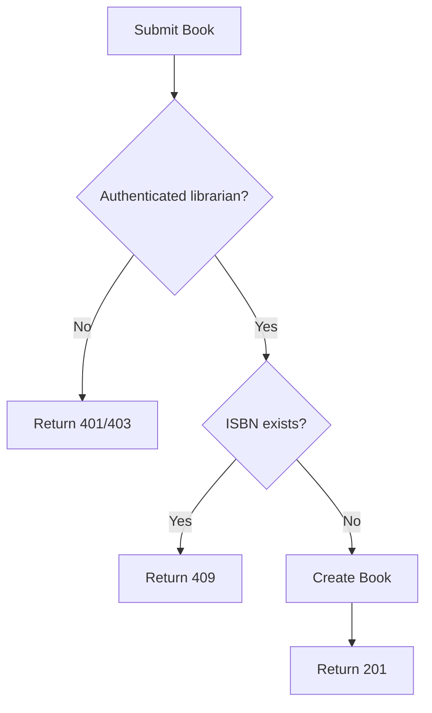
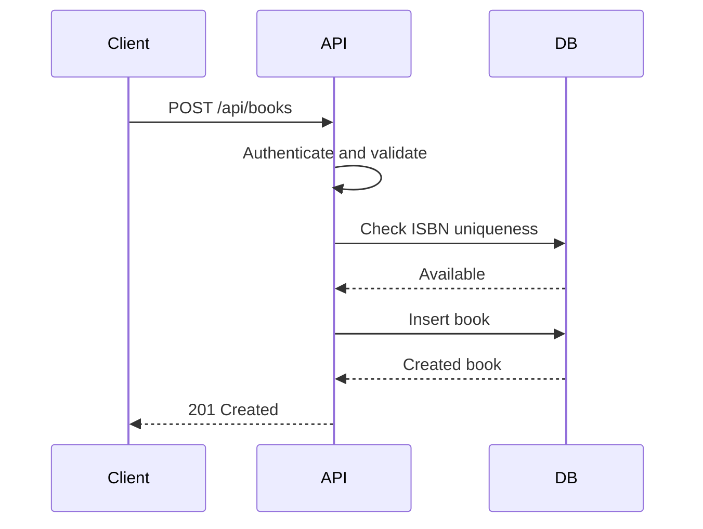
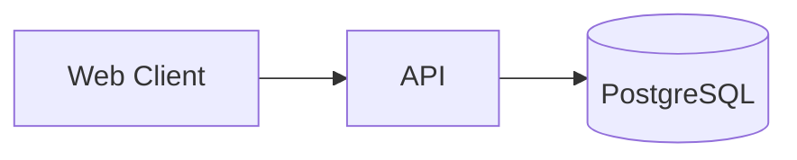

# Executable PRD Example

# PRD: Community Library Book Management

## Context

Librarians need to manage the library's book collection through a web application.

## Goals

- Create, update, search, and remove books.
- Prevent duplicate ISBNs.
- Restrict management operations to librarians.

## Non-goals

- Bulk CSV import
- External book metadata synchronization
- Book recommendation system

## Features

### Book Creation

#### Requirement

An authenticated librarian can create a book with title, author, ISBN, and category.

#### Business Rules

- ISBN must be unique.
- Title, author, and ISBN are required.

#### Acceptance Criteria

- AC-001: WHEN an authenticated librarian submits valid book data, THEN exactly one book is created.
- AC-002: WHEN the ISBN already exists, THEN the API returns `409` AND no second book is created.
- AC-003: WHEN a required field is missing, THEN the API returns `400` AND no book is created.
- AC-004: WHEN an unauthenticated user submits the request, THEN the API returns `401` AND no book is created.

#### Technical Definition

- PostgreSQL is the source of truth.
- ISBN uniqueness SHALL be enforced at the database level.
- Book creation SHALL be atomic.

#### API Contract

`POST /api/books`

Authentication: librarian role required.

Request:

```json
{
  "title": "Clean Code",
  "author": "Robert C. Martin",
  "isbn": "9780132350884",
  "category_id": "technology"
}
```

Success `201`:

```json
{
  "id": "book_123",
  "title": "Clean Code",
  "author": "Robert C. Martin",
  "isbn": "9780132350884",
  "category_id": "technology"
}
```

Errors:

- `400` invalid request
- `401` unauthenticated
- `403` insufficient permission
- `409` duplicate ISBN

#### Flow



#### Sequence



### Book Search

#### Requirement

An authenticated librarian can search books by title, author, or ISBN.

#### Acceptance Criteria

- AC-101: WHEN a search term matches a title, THEN matching books are returned.
- AC-102: WHEN a search term matches an author, THEN matching books are returned.
- AC-103: WHEN a search term matches an ISBN, THEN the matching book is returned.
- AC-104: WHEN no book matches, THEN the API returns an empty result set.

#### API Contract

`GET /api/books?q=<search-term>`

Authentication: librarian role required.

Success `200`:

```json
{
  "items": [
    {
      "id": "book_123",
      "title": "Clean Code",
      "author": "Robert C. Martin",
      "isbn": "9780132350884"
    }
  ]
}
```

## System Architecture



## Data Model

```text
Book
- id
- title
- author
- isbn UNIQUE
- category_id
- created_at
- updated_at
```

## Technical Constraints

- Use the existing authentication mechanism.
- Preserve existing API conventions.
- Do not introduce a second database.

## Definition of Done

- All acceptance criteria pass.
- Relevant automated tests pass or are added.
- API contracts are respected.
- No non-goal is implemented.
